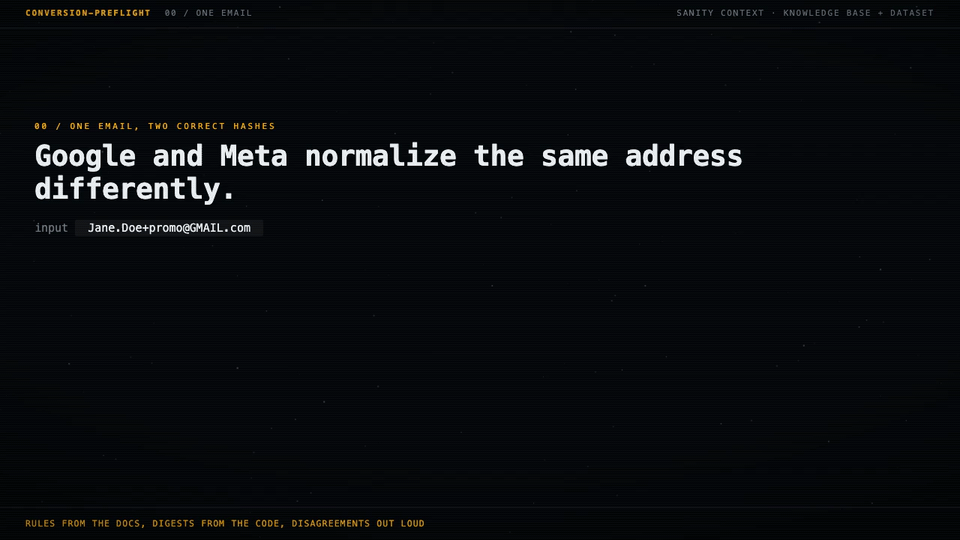
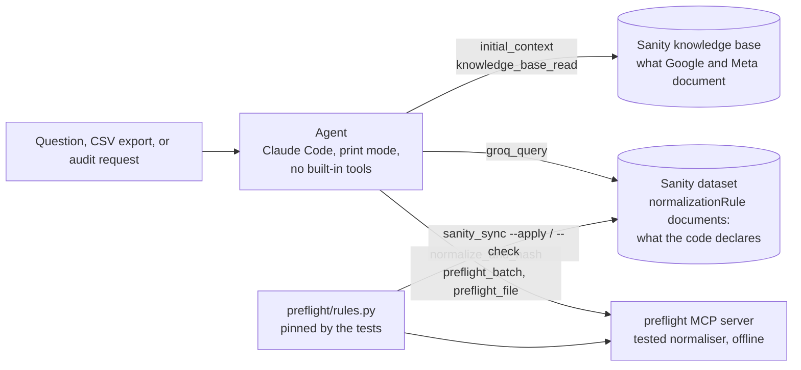

# conversion-preflight

An agent that checks customer data before an offline conversion upload to Google and Meta. What the platforms document comes from a Sanity knowledge base built from their own pages. What the code declares about its own rules comes from structured documents in a Sanity dataset, queried with GROQ. Every normalized value and SHA-256 digest comes from tested code. Where those disagree, the agent says so instead of picking one.



A real run over eight synthetic CRM rows, trimmed to three of its findings (the full transcript is in `examples/runs/`):

```text
$ python -m agent.run --csv examples/leads.csv --region US "Check these rows before tonight's upload to Google and Meta."
  -> preflight_file examples/leads.csv (6 columns mapped, id=Lead ID, region=US)
  -> initial_context
  -> groq_query *[_type == "implementationProfile"][0]{globalDivergences}
  -> knowledge_base_read ['normalization_and_hashing/google', 'normalization_and_hashing/meta']
  -> groq_query *[_type == "normalizationRule" && field in ["phone","country","first_name","last_name","em...

[6 turns, 14.3s, in 6+31541 cached, out 1895 tokens; transcript runs/...; upload file runs/uploads/leads-....upload.json]

## L-1006
- Google and Meta, phone `+1 (415) 555 0142 ext 7`: needs_review because it contains a letter (U+0065).
  - Google says every character after `+` must be a digit [normalization_and_hashing/google].
  - Meta says to remove symbols and letters [normalization_and_hashing/meta].
  - Refusing letters instead of stripping them is a declared divergence for both platforms
    [rule: google/phone] [rule: meta/phone].
  - Fix at source: store the extension in a separate field and send only the number.
- Google, first_name `Mrs. Carol`: warning. Google says to omit prefixes such as `Mrs.` from
  `given_name` [normalization_and_hashing/google]. The code doesn't remove them, which is declared
  [rule: google/first_name]. Fix at source: split the title into its own field.
## L-1008
- Google and Meta, email: invalid because it contains U+200B. ...
```

Digests never pass through the model's text. The agent sees the file's header and three rows and sends back a column mapping; `preflight_file` reads every row, writes the upload file keyed by lead id, and returns the totals and the flagged cells, never an accepted value or a digest. Citations say which source a claim came from: `[normalization_and_hashing/...]` is the knowledge base, `[rule: ...]` is the dataset.

## The problem

A hashed identifier either matches the one the platform computed or it does not, and a mismatch is silent: the upload succeeds, the conversion lands, and it is never attributed. The two platforms normalize differently, so one shared function is wrong for at least one of them:

| Input | Google (Data Manager API) | Meta (Conversions API) |
|---|---|---|
| ` Jane.Doe+promo@GMAIL.com ` | `janedoe@gmail.com` | `jane.doe+promo@gmail.com` |
| `(650) 555-1212`, US | `+16505551212` | `16505551212` |
| `O'Brien` | `o'brien` | `obrien` |
| ZIP `94035-1234`, US | `94035-1234`, sent in clear | `94035`, hashed |

Each of those is correct for its own destination and wrong for the other. The documentation that says so changes, is summarized by whatever tool reads it, and occasionally contradicts itself.

## How it works



Three sources, three jobs, and the agent is not allowed to blur them:

- **The knowledge base says what each platform documents.** A Sanity Context knowledge base built from Google's Data Manager formatting guide, Google Ads' offline conversions page, and Meta's customer information parameters, served by one Context MCP endpoint. Every rule the agent states is cited with the entry path, for example `[normalization_and_hashing/meta]`.
- **The dataset says what the code declares.** One `normalizationRule` document per platform and field carries the implementation in plain words, the platform's words when the code was written (verbatim, with the URL and retrieval date), the knowledge base entry that should agree today (`kbEntry`), the platforms' own worked examples, and the differences the code makes on purpose; an `implementationProfile` adds the differences that apply to every rule. A second Context MCP endpoint serves the dataset with a GROQ filter on those two types, and the agent cites a rule as `[rule: meta/phone]`. The documents are structured content, not summaries: a query returns the quote exactly as written. They are generated from `preflight/rules.py`, which the tests pin, by `python -m preflight.sanity_sync --apply`, and `--check` fails when the dataset and the code drift apart. The schema is in `studio/` and deployed at [conversion-preflight.sanity.studio](https://conversion-preflight.sanity.studio/); the dataset is private, so the Studio shows its documents to project members only.
- **The tools compute.** `normalize_and_hash`, `preflight_batch` and `preflight_file` are the only way a normalized value or digest may appear in an answer. `preflight_file` reads a CSV itself and writes the upload file itself, so no digest passes through the model's text; the model sees the header, three rows and the flagged cells.

The agent is Claude Code run headless (`claude -p`) with every built-in tool switched off and only these three MCP servers allowed. `agent/run.py` builds the command; `agent/system.md` is the whole prompt.

## Three requests it handles

**A question about the rules.** Answered from the knowledge base with citations, and when a value makes it clearer, both platforms' values side by side from the tool.

**Rows to check before an upload.** The agent maps CSV columns to canonical fields from the header and a few rows, says which it left out, and calls `preflight_file` once. The tool returns every value it did not accept and every warning about a value it accepted but the documentation says will not match (a `Mrs.` left in a Google given name, whitespace inside an email address, a Meta record with no country). The agent explains each one with the documented rule and what the source system has to fix. It never repairs a refused value.

**An audit of the implementation.** It queries every rule from the dataset and reads both normalization entries from the knowledge base, then compares three texts per rule: the knowledge base entry (the documentation today), the quote the code was written against, and what the code does. It sorts what it finds into undeclared disagreements between code and documentation, entries that disagree with the quoted source, declared divergences, and agreement.

## What building it found

Each of these was checked against the source page by hand before anything changed. Where it came from matters, so it is said.

- **Google's own Python sample contradicts Google's rule.** *Raised by the knowledge base build as a conflict between two entries.* On the Google Ads "Manage offline conversions" page (last updated 2026-09-24), `normalize_and_hash_email_address` in Python removes the `.` and `+` characters from the local part for every domain and keeps the text after the `+`. The page's rule, and its Java sample, apply the dot and plus-suffix removal to `gmail.com` and `googlemail.com` only and remove everything from the `+` on. Code copied from the Python sample turns `first.last@company.com` into `firstlast@company.com`, a digest that does not follow the documented rule.
- **Meta's page contradicts itself on UK postcodes.** *Flagged by the agent's audit.* The prose asks for "the area, district, and sector format", which for `M1 1AE` would stop at `m11`; the page's own example is `m11ae`, the whole postcode. The code follows the example and declares it.
- **A knowledge base entry is a summary, and summaries drop words.** *Flagged by the agent's audit* in three builds: one kept "trim leading and trailing whitespace" for Google email and lost "intermediate"; one invented "5-digit equivalents only" for non-US postal codes, after which the agent, reading that entry, advised cutting the Brazilian CEP `24020-005` to `24020`; a single-entry rebuild wrote "Base64 encoding is not used", which is true of the Google Ads samples and false for the Data Manager API. The fixes that survive rebuilds are knowledge base instructions and the purpose text.
- **Footnotes can point at the wrong page.** *Found by reading the entry against both pages.* In one build, several claims that exist only on the Data Manager page were footnoted to the Google Ads page.
- **The first crawl indexed one page in fifteen languages.** *Found in the crawled-pages view.* The Data Manager source came back as the formatting page plus fourteen `?hl=` translations, and a later check pulled nineteen translations of the Google Ads page. Turning on "Ignore query parameters" did not stop it; the translations were removed by hand.
- **The code had behaviour nobody had written down.** *Flagged by the agent's audit.* Letters in a phone number are refused rather than stripped, numbers shorter than eight digits are refused although E.164 has a few seven-digit ones, spaces inside a Meta first name are removed (`Mary Ann` becomes `maryann`), and the country for a national number comes from the record or the account. All of it is declared now, and each declaration has a test that pins it to the code's behaviour.
- **Two digests were wrong and reported as fine.** *Found by adversarial reviews of this repository, which also found a region that was not two letters skipping the ZIP rule, CSV columns lost without a trace, and a demo in which the model composed a phone number for a value the tool had refused. All fixed and tested.* `+44 (0)20 7946 0958` became `+4402079460958`, and a US ZIP+4 with no known country was hashed whole for Meta. Both now come back as `needs_review`. The phone case also affects the upstream library this normaliser is vendored from.

## Evaluation

`python -m eval.run_eval` runs 14 cases through the agent and grades them by code. Expected digests come from the tested normaliser and, for three cases, from digests Meta publishes on its own page. The digest rule is about provenance: every 64-character hex string in an answer must be an expected value or must appear in a tool result from the same run, so a digest the model wrote itself fails the case even when the right one is also present.

| Case group | Full agent: knowledge base, dataset, tools | Knowledge base only (same prompt) |
|---|---|---|
| Values whose digest Meta prints on its page (3) | 3 / 3 | 3 / 3 |
| Values whose digest has to be computed (3) | 3 / 3 | **0 / 3** |
| Refusals: no country, invisible character, country name (3) | 3 / 3 | 3 / 3 |
| Rule questions (5) | 4 / 5 | 4 / 5 |
| **Total** | **13 / 14** | **10 / 14** |
| Hex digests the model wrote itself | **0** | **0** |

The knowledge base alone is enough for the rules and for any digest a platform happens to print, which the baseline copied out of the entry. Every other digest needs the tool: without it the model did not invent one, it declined to compute it, which is honest and useless for an upload. The baseline also moves between runs, by which of the published digests it copies.

Both modes failed the same rule case, K4. Asked what to send as Google's `postal_code` for the Brazilian CEP `24020-005`, the full agent said the tool sends `24020-005` unchanged and that the documentation does not settle whether `-005` counts as an extension, and it would not recommend a value; the case requires one. The answer is not wrong, and it is still a fail: the criteria were fixed before the run and were not changed after it.

The grader has three versions, all recorded in each result file. Version 1 failed any digest that was not an expected value, which failed a correct answer that illustrated a rule with digests the tool had produced. Version 2 checks provenance instead, forbids any digest in a refusal, and grades rule questions on the claim that answers them. Version 3 tightened the rule-case patterns against counterexamples from an adversarial review of this repository; those counterexamples are tests. Rule cases are still keyword checks, not judgement, so every graded answer is published in `eval/transcripts/`, and `--regrade` reproduces the results from them. The numbers above are a fresh run with the final prompt and grader version 3. "Hex digests" is literal: a Base64 or truncated digest would not be counted, and none of the published answers contains one.

`--kb-only` runs the baseline, `--only V1 K4` runs a subset, and `--regrade runs/<dir>` grades saved transcripts again without calling the model and writes a new, separately named result file. `python -m eval.export` strips a raw transcript down to prompt, messages, tool calls, results and the answer before it is published.

## Running it

Requirements: Python (tested on 3.14), Claude Code installed and logged in, a Sanity organization with Context enabled (Manage, Labs), and, only to deploy the Studio, Node.js.

```bash
python -m venv .venv && ./.venv/bin/pip install -r requirements.txt
cp .env.example .env    # then fill in the values
./.venv/bin/python -m pytest -q

./.venv/bin/python -m agent.run "Does Meta want the dots removed from Gmail addresses?"
./.venv/bin/python -m agent.run --csv examples/leads.csv --region US "Check these rows."
./.venv/bin/python -m agent.run --audit
./.venv/bin/python -m eval.run_eval
```

`.env` holds `SANITY_ORGANIZATION_TOKEN` (an organization token with the Context Viewer role), `SANITY_CONTEXT_MCP_URL` (the knowledge base endpoint), `SANITY_DATASET_MCP_URL` (the dataset endpoint), and, only for publishing the rule table, `SANITY_PROJECT_ID`, `SANITY_DATASET` and `SANITY_PROJECT_TOKEN` (a project token with the Developer and Deploy Studio roles). `.mcp.json` reads them through environment expansion, so no key is written into a config file.

The Studio is only needed once, because a Context endpoint serves a dataset only when a Studio with its schema is deployed:

```bash
cd studio && npm ci --ignore-scripts    # exact versions from package-lock.json
SANITY_AUTH_TOKEN=<project token> npx sanity deploy
```

Each run is saved under `runs/` as JSON lines, one event per line; `preflight_file` writes its upload file under `runs/uploads/`.

## Layout

```text
preflight/identity.py     normaliser, vendored unchanged from revenue-loop (MIT)
preflight/rules.py        the rule table: implementation, verbatim quote, source, examples, divergences
preflight/core.py         normalize_and_hash, preflight_batch, preflight_file and its warnings
preflight/mcp_server.py   stdio MCP server for the agent
preflight/sanity_sync.py  publishes the rule table to the Sanity dataset and checks for drift
preflight/common.py       .env loader, digest pattern, transcript summaries
agent/system.md           the agent's prompt
agent/run.py              headless runner, transcript, upload file
eval/                     cases, the grader, the transcript export, results and transcripts
studio/                   Sanity Studio: schema for normalizationRule, docExample, implementationProfile
examples/                 synthetic CRM export and two published runs (a batch check and an audit)
tools/mcp_probe.py        talks to the knowledge base endpoint over plain HTTP, no model
tests/                    the suite
```

## Limits, stated plainly

- Phone numbers without a country code resolve for six numbering plans (US, CA, GB, AU, BR, DE) and are refused for any other region. A trunk zero written inside an international number is refused for the countries whose numbers never continue with 0 (44, 49, 55, 61); other countries are not checked, because some, Italy among them, keep the 0.
- Google city, state (`administrative_area`) and `address_line`, and Meta date of birth, gender and `external_id`, are not implemented. City and state return `not_implemented` with the knowledge base entry that documents them; the others are not canonical fields and return `unknown_field`.
- The warnings are heuristics written down, not rules: a short list of titles and suffixes, whitespace inside an email address, a missing Meta country. They never change a value.
- `preflight_file` returns at most 200 findings to the agent; the upload file has all of them. Very large exports belong in a script that calls `preflight.core.preflight_file` directly.
- Knowledge base entries are rewritten on every build and are not deterministic. Instructions and the purpose text stabilize the facts that matter; the audit is how you notice which detail went missing this time. An instruction corrects a fact an entry already covers; it did not make the build add a subject no entry described.
- The agent runs through Claude Code's print mode on the account it is logged in with.

## Tests

```bash
./.venv/bin/python -m pytest -q
```

The vendored normaliser keeps its upstream tests, with only their import lines changed. On top of them: every worked example with an input that the platforms publish is run through the code and must match or be marked as a declared divergence, every published digest is checked against its published normalized value, each declared divergence is pinned to the code's behaviour, the file check is tested for path escapes and missing columns, the MCP server is exercised over real stdio, and the grader is tested against invented digests, digests in refusals, wrong claims in plain words and right ones.

## License

MIT. `preflight/identity.py` is vendored from [revenue-loop](https://github.com/vinimabreu/revenue-loop) at commit `265d1c9`, also MIT.
